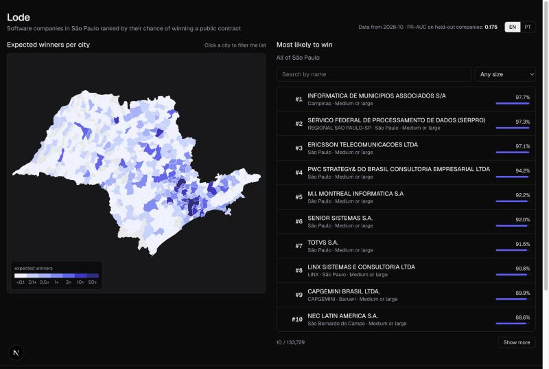

# Lode

**Lode finds the companies most likely to buy, in a haystack of millions of public CNPJ records.**

> 🚧 Work in progress — see the [roadmap](#roadmap).

Sales teams that sell to other businesses usually pay for lead databases. Brazil publishes
much of that data for free: every registered company (Receita Federal), every public contract
(PNCP), every economic activity code (IBGE). Lode turns that raw data into a ranked list of
prospects: a map, filters, and the top 10 companies for each filter, scored by a model and
checked by an LLM.

The first version focuses on **software and IT services companies (CNAE 62) in São Paulo**.



## How it works

1. **ETL** — downloads the monthly Receita Federal open data, keeps the target sector and
   state, and loads it into Postgres. Public contracts come from the PNCP API.
2. **Scoring model** — learns what a "good prospect" looks like and scores every company.
   The public demo uses *won a public contract* as the target, measured on held-out data.
   Uploading your own customer list to find lookalikes is planned.
3. **API** (FastAPI) — serves the map, filters and rankings. Scores are computed during the
   load, so the API stays light.
4. **LLM check** (gpt-oss on Groq, with Gemini as fallback) — reads the home page of each top
   company's website and says whether it is really the company's site and what it does,
   evaluated against a hand-labeled set.
5. **Web app** (Next.js) — the map and the prospect list.

## Roadmap

- [x] Project setup: sector definition, tests, CI
- [x] ETL: Receita Federal open data → Postgres
- [x] Public contracts (PNCP)
- [x] Scoring model with held-out evaluation
- [x] API
- [x] Web app: map, filters, top 10
- [x] LLM website check + evaluation set
- [ ] Deploy (Supabase + Vercel)

## Data

Loaded from the Receita Federal open data of **October 2026** (7.8 GB of zipped CSVs, ~66 million
establishment rows), in about 3.5 minutes on a laptop, streaming straight from the zip files:

| | |
|---|---|
| Companies (CNAE 62 as main activity, active, São Paulo) | 133,729 |
| Establishments (headquarters + branches) | 134,551 |
| Database size | 75 MB |

Things the data taught us:

- **Almost no MEI.** Only 3 of 133k companies are MEI (individual micro-entrepreneurs). Not a bug:
  software development and IT consulting are not allowed activities for MEI under Brazilian
  law, so one-person IT businesses register as regular micro companies instead.
- **Privacy by design (LGPD).** Partner names and CPFs are never stored, only counts and age
  bands. Individual businesses carry the owner's CPF at the end of their legal name; the ETL
  strips it.
- **Main activity only.** About as many companies list IT only as a *secondary* activity. They
  are left out to keep the focus on companies whose core business is IT.

Run it:

```bash
cp .env.example .env                                  # point DATABASE_URL to your Postgres
uv run python -m lode.etl receita --download          # latest month: download, extract, load
uv run python -m lode.etl receita --month 2026-10     # files already in data/raw/2026-10
uv run python -m lode.etl pncp --start 2025-11-01 --end 2026-10-31 --download
uv run python -m lode.etl geo                         # city codes and outlines for the map
```

The PNCP API only filters by publication date and is slow (~10 s per page of 500), so every
contract of each day is cached in `data/pncp/` as a gzipped JSON-lines file. Downloads resume
from the first missing day, and the cache can be filtered again if the target companies change.

Public contracts published from **November 2025 to October 2026** (365 days):

| | |
|---|---|
| Contracts published in the PNCP | 2,106,822 |
| Contracts won by our companies | 9,392 |
| Companies with at least one contract | 1,015 (0.8%) |
| Median contract value | R$ 25,680 |

Things the data taught us:

- **Few winners.** Less than 1% of the companies won a public contract in a year, so the model
  has to work with very imbalanced classes.
- **Very skewed values.** The median contract is about R$ 26 thousand, but the largest single one
  is above R$ 3.8 billion. Totals are meaningless here; medians and counts are not.
- **Mostly city halls.** Half of the contracts come from municipalities. The API also returns a
  buyer sphere `N` (620 contracts) that its documentation does not describe; it is kept as is.

## Model

The question: *looking at a company on 1 November 2025, will it win a public contract in the
next 12 months?* Features use only what was known on that date; the label is having a contract
published in the PNCP from November 2025 to October 2026. That leaves 109,041 companies opened
before the cutoff, of which 981 (0.9%) won.

20% of the companies are held out and only reported, never used to decide anything. On the
other 80%, 5-fold cross-validation picks the hyperparameters and chooses between a logistic
regression and gradient boosting (both scored on the same folds). Boosting would be chosen only
if its fold-by-fold gain were larger than the spread of that gain:

| Cross-validation (training rows) | PR-AUC, mean ± std over 5 folds |
|---|---|
| **Logistic regression** (C = 1) | **0.174 ± 0.016** |
| Gradient boosting (learning rate 0.05, 15 leaves) | 0.155 ± 0.016 |

**Chosen: logistic regression.** Boosting did not do better, and the logistic regression can be
explained coefficient by coefficient. Results on the 21,809 held-out companies, with 95%
bootstrap intervals (1,000 resamples):

| Ranking | PR-AUC | 95% interval | ROC-AUC | Precision in top 100 | Lift in top 10% |
|---|---|---|---|---|---|
| Random | 0.010 | 0.008–0.015 | 0.51 | 1% | 0.9× |
| Capital only | 0.117 | 0.089–0.158 | 0.89 | 20% | 7.1× |
| **Logistic regression** | **0.175** | **0.134–0.232** | **0.91** | **30%** | **7.7×** |
| Gradient boosting | 0.165 | 0.126–0.219 | 0.91 | 29% | 7.7× |

The paired difference between boosting and logistic is −0.042 to +0.020: a tie. The intervals
are wide because the holdout has only 196 winners; a single number like "0.175" hides that.

Accuracy is not reported on purpose: with 0.9% of winners, "nobody wins" is 99% accurate.
Classes are not reweighted either, so the score stays a real probability; reweighting would
barely change the ranking and would inflate every probability.

What the coefficients say: capital, the number of secondary activities, the number of partners
and company age raise the chance; micro companies and headquarters in the state capital lower
it (half of the
contracts come from city halls, which seem to buy from companies outside the capital). The
boosting model agrees: shuffling capital costs it 0.128 of PR-AUC, secondary activities 0.053
and age 0.037, while partner counts and number of establishments barely matter. That boosting
found no interaction worth having suggests the signal is mostly additive.

Things we learned the hard way:

- **A leak found through the coefficients.** A first version used a flag for "the whole partner
  list changed after the cutoff". It had a positive weight: winners change partners more often
  *after* winning. Nobody knew that on the cutoff date, so it was removed. The results barely
  moved (it affected 1,789 companies), but a model must not see the future.
- **Absurd scores found through the explanations.** Counts were first on a linear scale. Most
  companies declare up to 16 secondary activities, but a few micro companies declare 99, and
  the model extrapolated them to a 98% chance. Their score explanations showed it at once.
  Counts now go on a log scale (diminishing returns): the logistic regression improved
  (cross-validation 0.163 → 0.174) and those companies fell from the top 10 to rank 459 and
  below. Boosting did not change at all, as expected: trees only look at the order of values,
  and a log keeps the order.
- **Two features fighting each other.** The total number of partners always equals partners
  who are people + companies + foreigners, so with all four in the model the logistic regression
  gave TOTVS +2.3 for "partners" and −1.6 for "partners who are people": one effect split into
  two opposite weights. The predictions were fine, the explanation was not. Dropping the
  redundant count left the results unchanged (cross-validation 0.174 both ways) and made every
  explanation readable.

Known limitations:

- Capital, size, legal nature, secondary activities and partner counts are today's values: the
  Receita publishes no history for them. A company that grew *because* it won contracts looks
  bigger than it was on the cutoff date.
- Only companies active in October 2026 are in the database, so companies that closed during
  the year are missing (survivorship bias).
- Probabilities are well calibrated up to about 50%: on the holdout, companies predicted at
  2% won 2.4% of the time, at 9% won 11%, at 29% won 25%. Above 50% there are only 10
  held-out companies (predicted 72%, observed 60%), so the very top is likely overconfident.
- The holdout is a random split of the same year. A temporal check (train on one period, test
  on the next) needs more than one year of PNCP data.

Run it:

```bash
# ~30 s: prints the tables above, refits the chosen model on every labeled row, saves it to models/
uv run python -m lode.model train --cutoff 2025-11-01 --horizon-end 2026-11-01
# ~6 s: scores every company as it is today and stores score, rank and reasons in Postgres
uv run python -m lode.model score
```

The holdout has done its job (measuring) once training ends, so the model that scores companies
is refit on all 109,041 labeled rows with the hyperparameters chosen by cross-validation.
Scoring uses today's cutoff (the month after the Receita snapshot), so companies opened in the
last year are scored too. Each score comes with its reasons: in a logistic regression a
company's log-odds split exactly into one contribution per feature, measured against the
average company.

## API

A read-only [FastAPI](https://fastapi.tiangolo.com/) service. It only reads Postgres: scores,
ranks and reasons are computed at load time, so the API never loads the model.

```bash
uv run uvicorn lode.api.app:app --reload    # interactive docs at http://localhost:8000/docs
```

| Endpoint | What it returns |
|---|---|
| `GET /health` | Whether the API and the database answer |
| `GET /meta` | Data month, contracts period, model version and its holdout results |
| `GET /companies` | Companies from the highest score down. Filters: `municipality`, `size`, `min_score`, `q` (name); pages of up to 100 |
| `GET /companies/{cnpj_basico}` | One company, the public contracts it won and **why it got its score** |
| `GET /municipalities` | Per city: companies, mean score, best company and expected winners |

Choices worth explaining:

- **No contact data.** E-mails and phones are public in the Receita files, but for individual
  businesses they are often personal, so this public demo does not serve them (LGPD).
- **Reasons for every score.** In a logistic regression a company's log-odds split exactly into
  one contribution per feature. `GET /companies/{cnpj}` lists them, largest first, measured
  against the average company: for TOTVS, capital adds +4.3 and age +1.8.
- **Expected winners per city.** The sum of the probabilities of a city's companies. Since the
  scores are calibrated, it estimates how many of them will win a contract next year. Over the
  whole state it adds up to 1,107, close to the 1,015 winners of the last year.
- **Fast without a cache.** Listing, filters and name search answer in under 100 ms on 133k
  companies (city totals in about 300 ms): each company's trade name and city are copied next
  to its score at load time, the page and the total are separate queries (so the page walks
  the rank index and stops after `limit` rows), and name search uses trigram indexes
  (`pg_trgm`), which took it from 540 ms to 4 ms.

## Web app

Next.js and [MapLibre](https://maplibre.org/), in `web/`. One page: a map of São Paulo colored
by expected winners per city, the ranked list with search and filters, and a panel with each
company's public contracts and the reasons for its score. English by default, with an EN | PT
switch (also `?lang=pt` in the URL).

```bash
uv run uvicorn lode.api.app:app          # the API, on port 8000
cd web && npm install && npm run dev     # the web app, on http://localhost:3000
```

Choices worth explaining:

- **Cities matched by code, not by name.** The Receita identifies cities by their SIAFI code
  and maps use IBGE codes. Matching by name would lose cities to spelling ("SAO LUIZ DO
  PARAITINGA" vs "São Luís do Paraitinga"), so the National Treasury's open table that holds
  both codes is used, and the load fails if any city is left without a match.
- **No basemap.** Only the 645 city outlines from IBGE (283 KB), so there is no tile provider,
  key or cost.
- **The map draws in a web worker.** MapLibre 6 looks for its worker next to its own bundle,
  where Next.js does not put it; `npm run worker` copies it to `public/` before `dev` and
  `build`.

## LLM website check

The Receita has no website field, only the e-mail each company registered. For the top-ranked
companies, Lode takes the e-mail's domain (skipping free providers like gmail.com), reads the
home page, and asks an LLM three things: is this the company's own site, what does the company
do, and does the page mention public-sector clients. The answer shows in the company panel.

**Why an LLM and not a rule.** A domain is often not the company's: accounting firms register
their own e-mail for their clients (one domain is shared by 36 thousand companies), and some
domains redirect to another business. A simple rule — *unreadable page → unclear; domain shared
by 5 or more companies → no; otherwise yes* — is the baseline the LLM has to beat.

**How it was measured.** 100 companies drawn from the top of the ranking, labeled by hand in a
terminal tool (`python -m lode.site label`): 30 for development, 70 for a test set run only
once, at the end. Pages behind a bot wall are set apart, since no model can read them: 57 of
the 70 test pages were readable.

| Test set (57 readable pages) | Is it the company's site? | Mentions public clients? |
| --- | ---: | ---: |
| Rule baseline | 68% | 67% |
| LLM chain as run (gpt-oss, Gemini when rate-limited) | **77%** | 75% |
| gpt-oss 120B alone | 75% | **77%** |

What these numbers taught:

- **Development scores were too optimistic.** On the 30 development companies gpt-oss reached
  91% on both questions; on the test set, 75–77%. The rules in the prompt were written while
  looking at development mistakes, so they fit those cases best. That is why the test set was
  kept aside and run once.
- **Labels needed rules too.** The first comparison had the LLM *below* the rule (67% vs 73%).
  Reviewing the disagreements showed my own labels were inconsistent, so the same written
  guidelines (`src/lode/site/guidelines.py`) now feed both the labeling tool and the prompt:
  a different company name counts as "not the site" only when the page shows it, and "public
  clients" needs the page to name them, not a guess from the field.
- **A "yes" on websites is trustworthy; on public clients it is not.** When gpt-oss said a site
  was the company's, it was right 92% of the time. When it said the company sells to
  government, it was right 1 time in 4. So the app shows a verified site with confidence, but
  for the public sector it shows only the quote from the page, with a warning, and no yes/no
  badge or filter.
- **The page is untrusted input.** The prompt treats the page text as data, never
  instructions, and asks for the name on the page first, before any verdict.

**Running it.** Free tiers only: models are tried in order, and one that hits its rate limit
rests for five minutes at the back of the line. Pages and answers are cached, so a stopped run
resumes where it left off.

```bash
uv run python -m lode.site eval --split dev            # compare the LLM with the rule baseline
uv run python -m lode.site run --top 2000              # check the top companies' sites
```

Of the top 2,000 companies, 1,775 have an e-mail domain worth checking (the rest use free providers or none).

## Development

Requires Python 3.12+, [uv](https://docs.astral.sh/uv/) and a local Postgres.

```bash
uv sync                  # create the environment and install dependencies
uv run pytest            # run the tests
uv run ruff check .      # lint
```

## License

[MIT](LICENSE)
